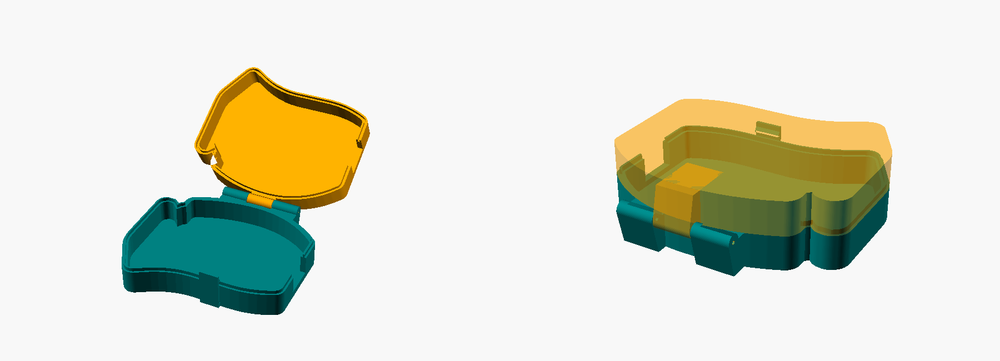

# Urchin tenting stand with palm rest


One stand per half. It tents the board, holds the case in a pocket, and puts a
palm rest in front at about home-row height, like the pads on a Kinesis
Advantage. Each half is 142 × 164 × 55 mm, so it fits a **Bambu Lab A1 mini**
(180 mm bed).

The pocket follows the real Urchin PCB outline (from
[duckyb/urchin](https://github.com/duckyb/urchin) `main.kicad_pcb`), grown by
`case_wall` + `clearance`.

## Files

| File | What |
|---|---|
| `out/urchin_stand_fit_test_left.stl` / `_right` | 2.4 mm ring of the pocket wall. **Print this first** (~10 min) |
| `out/urchin_stand_left.stl` / `_right` | The stands |
| `urchin_stand.scad` | Source. Open in OpenSCAD and use the Customizer |
| `urchin_outline.scad` | Urchin PCB outline (generated, don't edit) |

## Before the big print

1. Print a fit-test ring and drop the case in.
   - Too tight: raise `case_wall`.
   - Rattles: lower `case_wall`.
   - Re-export.
   The STLs assume a 3.0 mm case wall and 0.6 mm clearance. That's an estimate for the Coral case, not a measurement.
2. Measure `key_top_height`: desk to the top of a home-row keycap with the
   case flat on the desk. The default 15 mm is an estimate. Every key height
   on the stand shifts 1:1 with it, so this one matters most.

## How the heights are set

Keys are placed relative to the palm rest, not the desk. Desk height is just
chair height; what the hand feels is the distance from the palm rest to each
key. The targets come from an Advantage2 (left half, keycaps 15 mm tall on the
Urchin):

| Relative to the palm rest's back-inner corner | Advantage2 | Stand |
|---|---|---|
| D key, below | 20 mm | 20 mm (`d_below_palm`) |
| D key, behind the back edge (bird's eye) | ~50 mm | 54 mm, as close as the Urchin allows |
| A key vs D | level | 1 mm above |
| F key vs D | 10 mm above | 5 mm above |
| Relaxed thumb tip / point between the thumb keys | 3.5 mm above | 0.5 mm above |
| Palm rest inner edge | through the F key centre | same |

**Board: 10° tent, front edge up 17.5° (`tilt_angle` = −17.5).** A flat board
can't copy the Kinesis's curved wells, so these angles are a compromise:

- Raising the front edge lifts the thumb keys up to the palm rest. On the
  Advantage2 the relaxed thumb tip rests between Backspace and Delete, level
  with their tops, 3.5 mm above the palm rest.
- The cost is the top row, which ends up 5 mm below the home row (bottom row
  5 mm above). Going all the way to +3.5 mm for the thumb would take 21.5°
  and drop the top row 6 mm.
- F only gets 5 mm above D, not 10: F and D are neighbouring columns on a flat
  board, and the Kinesis's difference comes from its well's curve.

**Why not Kinesis's 20° tent?** That figure describes how far the key wells
are tipped, not the key tops. Across the home row the tops only drop about
10 mm from F to A.

**Palm rest: 6° toward the thumbs (`palm_side`), 15° toward the keys
(`palm_slope`)**, copied from the four corner heights of the Advantage2's palm
rest (20, 30, 50, 40 mm). It's also the pocket's front wall (`palm_gap` = 0),
to bring D as close as possible.

The board sits as low as `min_floor` allows, which puts the palm rest's
back-inner corner at 54 mm, 4 mm above the Kinesis. The OpenSCAD console
prints every key and palm-corner height.

## Settings worth trying

- `tent_angle`, `tilt_angle`: board angles. More tent raises F and the thumbs
  and lowers A; more negative tilt raises the thumbs and bottom row.
- `palm_target`, `d_below_palm`: palm rest height, and how far D sits below it.
- `palm_slope`, `palm_side`: the palm rest's own tilts, independent of the board.
- `palm_width` (default 80 mm): the inner edge stays on the F key, so this
  sets how far the rest reaches past the board's outer edge. It stops short
  of the thumb keys.
- `palm_gap` (default 0): space between palm rest and case.
- `pad_recess`, `pad_w`, `pad_d`: the palm pad recess (see below). `pad_recess = 0` removes it.

## Palm pads

Each palm rest has a 2 mm deep recess for a **58 × 56 mm** rounded-rectangle
pad. It's a plain rectangle so it's easy to cut, and easy to replace when it
wears out.

- **Material:** self-adhesive closed-cell foam sheet, 3 mm thick (neoprene or
  EPDM). A 300 × 200 mm sheet makes about 12 pads. With 3 mm foam the pad
  stands 1 mm proud of the plastic, so no hard edge touches your palm.
  Thicker or softer foam: set `pad_recess` to foam thickness − 1 mm.
- **Cutting:** print `out/palm_pad_template.svg` at 100 % (no "fit to page"),
  or just measure 58 × 56 mm with a ruler. Round the corners around a
  2-euro coin.
- **Kinesis's own pads** (AC005PP-BLK, 95 × 75 mm) are too big for this palm
  rest, and hard to find in Europe.

## Printing (A1 mini)

- PLA or PETG, 0.2 mm layers, 3 walls, 10–15 % gyroid infill.
- Print flat on its base, no supports. The USB and finger notches are open at the top.
- About 170–200 g and roughly 7–9 h per half.
- Optional: 10 mm silicone bumpons in the five recesses underneath.

## Re-exporting

```bash
openscad -o out/urchin_stand_left.stl -D 'part="left"' urchin_stand.scad
```

```bash
openscad -o out/urchin_stand_right.stl -D 'part="right"' urchin_stand.scad
```

# Travel case



A clamshell made of two trays. Each tray holds one half face-up with the
keycaps 1 mm below the rim. The two halves are mirror images, so the trays
close face to face: the bottom tray's lip fits into a groove in the top tray,
and nothing presses the keys. A hinge joins them along the back, and a snap
latch holds the front shut. Closed, it's about 124 × 114 × 35 mm.

| File | What |
|---|---|
| `out/urchin_travel_case_bottom.stl` | Holds the **right** half, has the lip |
| `out/urchin_travel_case_top.stl` | Holds the **left** half, has the groove. Flip it over to close |
| `urchin_travel_case.scad` | Source |

- The pockets use the same `case_wall` and `clearance` as the stand. If the
  stand's fit-test ring fits your case, these fit too.
- Measure `tallest_point`: desk to the highest part of a half (keycap, or the
  nice!nano if it sits higher). Default 15 mm. Too low, and the halves press
  each other's keys in the bag.
- `lip_fit` sets how snugly the trays close. Raise it if they're too tight,
  lower it if they rattle.
- Each tray takes about 45–55 g and 2–3 h. Print open side up, no supports.

**Hinge.** The trays are too wide to print already joined (about 250 mm
open), so each prints with its own knuckles. The pin is a 62 mm piece of
1.75 mm filament: push it through all three knuckles, then flatten each end
with a soldering iron or a lighter so it can't slide out. If the pin is loose,
lower `pin_d` to 1.9. The case opens all the way to 180°.

**Latch.** A flexible tab on the bottom tray's front edge has a tooth that
snaps into a slot in the top tray. Press the lid down to close it. To open,
pull the top of the tab outward with a fingernail and lift. If it's too stiff,
lower `tab_t` (1.4 mm). If it doesn't hold, raise `tooth` (1.2 mm).

`hinge` and `latch` can each be switched off. `band_w` adds a groove for a
rubber band instead.

Re-export:

```bash
openscad -o out/urchin_travel_case_bottom.stl -D 'part="bottom"' urchin_travel_case.scad
```

```bash
openscad -o out/urchin_travel_case_top.stl -D 'part="top"' urchin_travel_case.scad
```
